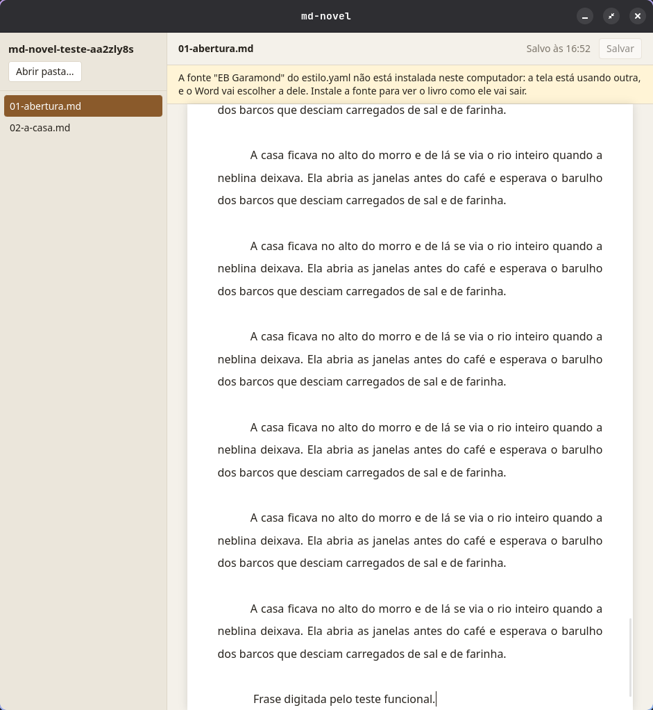
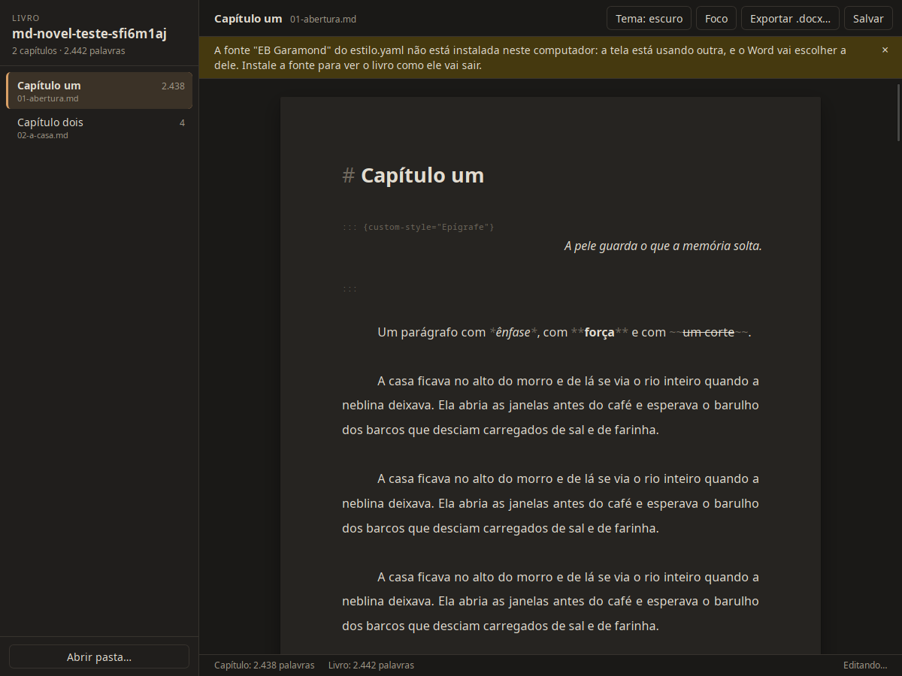

# md Novel

Um estilo só para o livro inteiro. Você escreve os capítulos em Markdown, um
arquivo por capítulo, e descreve a tipografia uma vez num `estilo.yaml`: fonte,
tamanho, entrelinha, alinhamento, recuo e espaços. Desse arquivo saem o CSS do
editor e o `reference.docx` do Pandoc, de modo que a tela e o .docx recebem as
mesmas propriedades.

**Estado:** há um programa de desktop na primeira versão (abre a pasta do
livro, edita com a tipografia do `estilo.yaml`, conta as palavras, salva e
exporta o .docx) e uma linha de comando, que gera o CSS, o reference.docx e
também exporta.





## Instalação da linha de comando

Precisa do Rust (pelo [rustup](https://rustup.rs)) e do Pandoc 3 (testado com
o 3.11).

No Arch Linux:

```bash
sudo pacman -S rustup pandoc-cli
```

```bash
rustup default stable
```

No macOS, instale o Rust pelo [rustup.rs](https://rustup.rs) e o Pandoc pelo
Homebrew:

```bash
brew install pandoc
```

Depois, de dentro desta pasta:

```bash
cargo install --locked --path crates/cli
```

O comando `md-novel` fica em `~/.cargo/bin`.

## O programa de desktop

Além do Rust e do Pandoc, precisa do Node 22, do `cargo tauri`
(`cargo install tauri-cli --version "^2" --locked`) e, no Linux, do WebKitGTK
(`sudo pacman -S webkit2gtk-4.1` no Arch).

```bash
cd app && npm ci --ignore-scripts && cargo tauri build --no-bundle
```

O programa fica em `target/release/md-novel-app`. Abra passando a pasta do
livro, ou sem nada e use "Abrir pasta…":

```bash
./target/release/md-novel-app ~/Dropbox/meu-livro
```

No Linux, para ele aparecer no menu de aplicativos como "md Novel", rode da
pasta do projeto, em vez do comando de compilar acima:

```bash
make instalar
```

Isso compila e copia três arquivos para `~/.local`: o programa
(`bin/md-novel-app`), o ícone e a entrada do menu. Rode de novo depois de
atualizar o projeto. `make desinstalar` apaga esses três arquivos; a escolha
de tema, que o programa guarda em `~/.local/share/io.github.mateuscamp.md-novel`,
fica. No Mac ainda não há instalação: abra pelo terminal.

O que ele faz hoje:

- Os capítulos são os arquivos `.md` da pasta, em ordem de nome. Nada é
  criado nem mudado na pasta ao abrir.
- O texto aparece com a tipografia do `estilo.yaml` da pasta, inclusive os
  estilos nomeados dos blocos `:::`. Sem `estilo.yaml`, ou com ele inválido,
  o programa avisa e abre os capítulos assim mesmo. Na pasta sem estilo o
  aviso traz o botão "Criar estilo.yaml", que grava ali o modelo comentado
  (o mesmo de `exemplos/estilo.yaml`); um estilo que já existe nunca é
  trocado.
- O botão "Estilo" abre um painel para mudar a fonte, o tamanho, a
  entrelinha, o alinhamento, o recuo e os espaços, do texto do livro e dos
  estilos nomeados. A mudança aparece na hora e vai para o `estilo.yaml`.
  Comentários escritos à mão no arquivo não são guardados pelo painel.
- Salva sozinho um instante depois de você parar de digitar, ao trocar de
  capítulo e ao sair da janela (e com Ctrl+S). O arquivo volta ao disco no
  formato em que estava.
- Se o arquivo mudou no disco depois que você abriu (outro computador pelo
  Dropbox, outro editor), ele não grava por cima: avisa e oferece recarregar.
- Avisa quando a fonte do estilo não está instalada.
- A lateral mostra cada capítulo pelo título (o primeiro `# ...` do texto),
  com o nome do arquivo e o número de palavras, e o total do livro. A barra
  de baixo conta as palavras do capítulo enquanto você digita, as da seleção
  e as do livro.
- O Markdown fica à vista: itálico, negrito e títulos aparecem como vão
  sair, e os sinais que você digitou (`*`, `#`) continuam na tela, apagados.
- Tema claro e escuro. O botão "Tema" passa por sistema, claro e escuro, e a
  escolha fica guardada. O tema é só da janela: não muda o .docx.
- Modo foco (botão "Foco" ou F8): fica só a folha. Esc ou F8 sai. Os avisos
  continuam aparecendo.
- Zoom do texto com Ctrl+rolagem, Ctrl+= e Ctrl+- (Ctrl+0 volta a 100%): a
  folha aproxima, a lateral e as barras ficam do mesmo tamanho.
  O botão ☰, ou F9, esconde a lateral. "Máquina", ou F10, liga a máquina de
  escrever: a linha em que você escreve fica no meio da tela. F11 é tela
  cheia. Zoom, lateral e máquina de escrever ficam guardados.
- Corretor ortográfico em português: palavra errada ganha o sublinhado
  vermelho. No Linux precisa do dicionário do hunspell (`hunspell-pt-br`, que
  no Arch está no AUR); sem ele o programa avisa. No Mac usa o do sistema.
- "Novo capítulo…", na lateral, cria um capítulo vazio na pasta do livro e
  já sugere o próximo número. Renomear, apagar e reordenar continuam sendo
  feitos na pasta.
- Aberto pelo menu, o programa volta ao último livro, no capítulo e na linha
  em que você parou.
- A barra de baixo mostra as palavras escritas hoje no livro. Clique nelas
  para definir a meta do dia; campo vazio tira a meta.
- Buscar e substituir com Ctrl+F (ou Ctrl+H), dentro do capítulo aberto.
- Parágrafos como no Word: Enter cria um parágrafo novo, e a linha em branco
  que o Markdown pede entre eles fica no arquivo, mas não aparece na tela.
  Backspace no começo de um parágrafo junta com o de cima; Shift+Enter é a
  quebra de linha simples.
- "Converter sinais", na barra de baixo, troca de uma vez, no capítulo
  aberto, os hifens duplos (`--` e `\--`) por travessão e as aspas retas por
  curvas. Ctrl+Z desfaz.
- Aspas curvas e travessão ao digitar: `"` vira “ ”, `'` vira ‘ ’ e `--` vira
  —. O botão "Aspas" da barra de baixo desliga. Nas linhas `:::`, em código
  e em links o sinal fica reto.
- "Exportar .docx…" salva o que está na tela, pergunta onde gravar e gera o
  livro inteiro, com os capítulos em ordem e o estilo do `estilo.yaml`. Os
  avisos do Pandoc (uma imagem que não foi achada, por exemplo) aparecem na
  janela. Sem `estilo.yaml` o .docx sai com o estilo padrão do Pandoc, com
  aviso; com o `estilo.yaml` inválido nada é exportado.

O que ainda não faz: ordenar capítulos fora da ordem de nome, dar aos títulos a cara do .docx e perceber
sozinho, com o programa aberto, que um arquivo mudou. Não há pacote pronto
para baixar: instalar é compilar.

## Uso da linha de comando

Copie [`exemplos/estilo.yaml`](exemplos/estilo.yaml) para a pasta do livro e
ajuste. Cada chave está comentada no próprio arquivo.

**Gerar o CSS e o reference.docx:**

```bash
md-novel estilo estilo.yaml --css editor.css --docx reference.docx
```

**Exportar o livro para .docx:**

```bash
md-novel exportar --estilo estilo.yaml --saida livro.docx 01-abertura.md 02-a-casa.md
```

Os capítulos entram na ordem em que você os passa. Com nomes numerados,
`md-novel exportar --estilo estilo.yaml --saida livro.docx 0*.md` já sai na
ordem. Imagens são procuradas a partir da pasta de cada capítulo.

**Estilos nomeados** (epígrafe, carta, separador) vão no capítulo assim:

```markdown
::: {custom-style="Epígrafe"}
A pele guarda o que a memória solta.
:::
```

No .docx, o parágrafo sai com o estilo de mesmo nome, que você também encontra
na lista de estilos do Word.

## Com o Zettlr

1. Gere o CSS com o seletor de linha do editor do Zettlr:

   ```bash
   md-novel estilo estilo.yaml --css zettlr.css --docx reference.docx --seletor-corpo ".cm-content .cm-line"
   ```

2. No Zettlr, abra o gerenciador de recursos (Assets Manager), na aba de CSS
   personalizado, e cole o conteúdo de `zettlr.css`.
3. Para exportar, use o `md-novel exportar`, ou aponte o perfil de exportação
   para Word do Zettlr para o `reference.docx` gerado, com a chave
   `reference-doc`.

Gere de novo e cole de novo sempre que mudar o `estilo.yaml`.

No Zettlr há limites que o programa de desktop já resolve em parte:

- Os estilos nomeados não aparecem na tela, só no .docx: o Zettlr não marca os
  blocos `:::`.
- Recuo e justificação valem para toda linha, inclusive títulos e linhas em
  branco.
- O seletor `.cm-content .cm-line` foi tirado da documentação do Zettlr 3 e não
  foi conferido numa instalação; se nada mudar na tela, veja a classe da linha
  nas ferramentas de desenvolvedor do Zettlr.

## O que esperar

- **Mesmas propriedades, não a mesma página.** O navegador e o Word medem as
  fontes e hifenizam de jeitos diferentes.
- **Entrelinha aproximada na tela.** O Word mede a linha simples pela fonte; o
  CSS usa 1,2 vez o tamanho, a menos que o editor defina
  `--md-novel-linha-simples`.
- **Título é o que o Pandoc lê como título.** Ele precisa de uma linha em
  branco antes: um `# ...` colado no parágrafo de cima sai como texto, e é
  assim que a tela mostra. O título sublinhado (uma linha de `===` ou `---`
  logo abaixo do texto) o programa ainda não reconhece na tela, mas o Pandoc
  sim: deixe uma linha em branco antes de um `---` de quebra de cena.
- **Só de ida.** O md Novel não lê de volta o .docx revisado pela editora: as
  mudanças voltam para os .md à mão ([ADR 0001](docs/adr/0001-exportar-so-de-ida-md-para-docx.md)).
- **Fica de fora, por enquanto:** títulos, tamanho de página, margens e
  hifenização usam o padrão do Pandoc
  ([ADR 0002](docs/adr/0002-estilo-yaml-fonte-unica-com-propriedades-explicitas.md)).

## Desenvolvimento

```bash
make check
```

Confere a interface (tipos, testes, build) e depois formata, roda o clippy e
a suíte inteira do Rust; precisa do `pandoc` no PATH, do Node e, no Linux, do
`webkit2gtk-4.1`. O CI roda o mesmo comando no Linux e no Mac arm64. Regras do repositório em
[AGENTS.md](AGENTS.md), decisões em [docs/adr](docs/adr/README.md).

## Licença

O md Novel é software livre, sob a GNU General Public License, versão 3
(`GPL-3.0-only`): você pode usar, estudar, modificar e redistribuir, desde
que o que redistribuir continue sob a mesma licença. Ele vem sem garantia
nenhuma. O texto completo está em [LICENSE](LICENSE).

Copyright © 2026 Mateus Campelo
